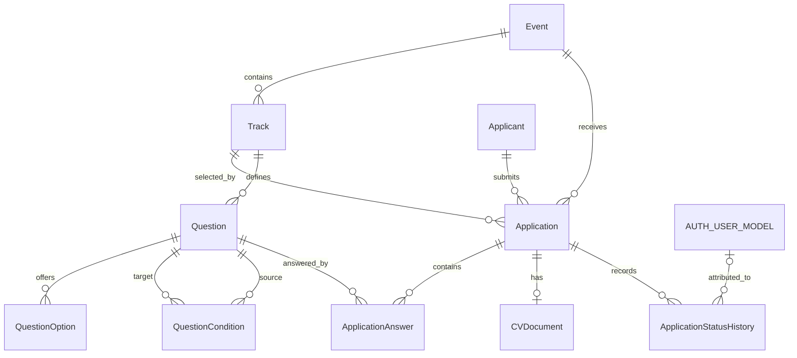

# Recruitment database schema

## Common conventions

All models have `id UUID PRIMARY KEY`, generated by Python uuid4; foreign keys are
non-null unless explicitly noted. Django automatically indexes ForeignKey columns;
OneToOneField and unique fields have unique indexes. Strings described as optional
use blank strings rather than SQL NULL. Optional datetimes use NULL. Dates use
timezone-aware Django datetimes. Default table names are `recruitment_<modelname>`.

Event, Track, Question, QuestionOption, Applicant, Application and ApplicationAnswer
also have `created_at` (auto_now_add) and `updated_at` (auto_now). Conditions have
created_at; CVDocument has uploaded_at; status history has changed_at. These immutable
record types do not need a generic updated_at field.

## Fields

| Model | Significant columns beyond UUID/timestamps |
| --- | --- |
| Event | title varchar(200); slug slug(160) unique; description text optional; starts_at, ends_at, applications_open_at, applications_close_at nullable datetime; status varchar(16) default DRAFT; privacy_notice_url URL(500) optional for drafts; privacy_notice_version varchar(80) optional for drafts; retention_days positive integer default 365 |
| Track | event FK; name varchar(150); code slug(80); description text optional; is_active boolean default true; display_order positive integer default 0 |
| Question | track FK; key slug(80); title text; description text optional; question_type varchar(20); is_required/is_active booleans default true; display_order positive integer default 0; placeholder varchar(250) optional; settings JSON default empty dict |
| QuestionOption | question FK; value slug(100) stable; label varchar(200); display_order positive integer default 0; is_active boolean default true |
| QuestionCondition | target_question FK; source_question FK; operator varchar(16); expected_value typed JSON; created_at datetime |
| Applicant | full_name varchar(200); email EmailField(254); mobile_number varchar(40); university/faculty_or_major varchar(200); graduation_year nullable positive integer; education_status varchar(20); city varchar(120); linkedin_url URL(500) optional |
| Application | event/applicant/track FKs; opportunity_type/experience_level/availability varchar(24); preferred_work_arrangement/status varchar(16); submitted_at nullable datetime; privacy_notice_version varchar(80) optional in drafts; privacy_acknowledged_at/external_cv_sharing_authorized_at nullable datetime; future_opportunities_opt_in boolean default false |
| ApplicationAnswer | application/question FKs; response typed JSON; no meaningless empty optional answer rows |
| CVDocument | application one-to-one; storage_key varchar(200) unique generated cvs/UUID; original_filename varchar(255); file_extension varchar(8); content_type varchar(120); size_bytes positive bigint; sha256_checksum varchar(64) optional; security_scan_status varchar(12) default PENDING; uploaded_at datetime |
| ApplicationStatusHistory | application FK; previous_status varchar(16) nullable; new_status varchar(16); changed_by nullable FK to settings.AUTH_USER_MODEL; note text optional; changed_at datetime |

No password belongs to an Applicant. File binaries are not stored in any table.
UUIDs are identifiers, not authorization secrets; knowing one never grants access.

## Enumerations

All fixed enums use Django TextChoices and database CHECK constraints:

- Event.Status: DRAFT, PUBLISHED, CLOSED.
- Question.Type: SHORT_TEXT, LONG_TEXT, SINGLE_CHOICE, MULTIPLE_CHOICE, YES_NO,
  NUMBER, URL.
- QuestionCondition.Operator: EQUALS, NOT_EQUALS, CONTAINS.
- Applicant.EducationStatus: STUDENT, FRESH_GRADUATE, GRADUATE.
- Application.OpportunityType: INTERNSHIP, FULL_TIME, PART_TIME,
  GRADUATE_PROGRAMME, OPEN_TO_ALL.
- Application.ExperienceLevel: NO_EXPERIENCE, LESS_THAN_ONE_YEAR, ONE_TO_TWO_YEARS,
  THREE_TO_FIVE_YEARS, MORE_THAN_FIVE_YEARS.
- Application.WorkArrangement: ONSITE, HYBRID, REMOTE, FLEXIBLE.
- Application.Availability: IMMEDIATELY, WITHIN_ONE_MONTH, WITHIN_THREE_MONTHS, FLEXIBLE.
- Application.Status (also history previous/new): DRAFT, SUBMITTED, IN_REVIEW,
  SHORTLISTED, REJECTED, WITHDRAWN.
- CVDocument.ScanStatus: PENDING, CLEAN, REJECTED, FAILED.

## Relationships and deletion

| Referencing field | Target | Django on_delete | Rationale |
| --- | --- | --- | --- |
| Track.event | Event | PROTECT | Configure/close an event rather than deleting its tracks implicitly. |
| Question.track | Track | CASCADE | Empty configuration may be explicitly removed; referenced questions/conditions can block deletion. |
| QuestionOption.question | Question | CASCADE | Options are question configuration. Admin disables option deletion; deactivate to retain stable answer values. |
| QuestionCondition.target_question | Question | CASCADE | A target's visibility conditions belong to it. |
| QuestionCondition.source_question | Question | PROTECT | Prevent removal of a dependency source. |
| Application.event | Event | PROTECT | Preserve application event identity. |
| Application.track | Track | PROTECT | Prevent deleting any track with applications, including drafts. |
| Application.applicant | Applicant | PROTECT | Prevent identity deletion while applications exist. |
| ApplicationAnswer.application | Application | CASCADE | Explicit application purge removes its answer data. |
| ApplicationAnswer.question | Question | PROTECT | Preserve question references for all answers, including draft answers. |
| CVDocument.application | Application | CASCADE | Metadata belongs to an application; actual storage deletion requires the future purge service. |
| ApplicationStatusHistory.application | Application | CASCADE | Routine status updates preserve history; explicit authorized retention purge removes related personal data. |
| ApplicationStatusHistory.changed_by | AUTH_USER_MODEL | SET_NULL | Removing a staff user preserves the historical transition record. |

These on_delete policies are Django ORM collector behavior, not a claim of SQL
ON DELETE CASCADE/PROTECT clauses in PostgreSQL. SQL foreign keys enforce reference
integrity; raw deletion must respect those constraints. Purge coordination is deferred.

## Database uniqueness and checks

| Model | Database-enforced rules |
| --- | --- |
| Event | Unique slug; valid status; ends_at >= starts_at when both exist; applications_close_at >= applications_open_at when both exist; retention_days > 0; PUBLISHED requires non-empty privacy URL/version. URL validity, HTTPS and non-whitespace content are model checks. |
| Track | Unique (event, code); foreign key integrity; nonnegative display order. |
| Question | Unique (track, key); valid type; nonnegative display order. |
| QuestionOption | Unique (question, value); nonnegative display order. |
| QuestionCondition | source != target; valid operator; foreign key integrity. |
| Applicant | Unique expression LOWER(TRIM(email)); valid education status; nonnegative graduation_year when set. Model saves strip and lowercase the complete email as this portal's explicit identity policy. |
| Application | Unique (event, applicant); all enum membership; draft has no submitted_at; statuses SUBMITTED/IN_REVIEW/SHORTLISTED/REJECTED require submitted_at; any submitted_at requires privacy acknowledgement and non-empty version. WITHDRAWN can represent a withdrawn draft or submitted record. |
| ApplicationAnswer | Unique (application, question). |
| CVDocument | Unique application and storage_key; 0 < size_bytes <= 10,485,760 (10 MiB); extension in pdf/doc/docx; valid scan status. |
| ApplicationStatusHistory | Valid new status; previous status NULL or valid enum. |

Email normalization uses PostgreSQL/SQLite LOWER and TRIM semantics. The model
normalizes input before email validation. Internationalized email identity policy,
if introduced later, needs explicit review rather than assuming Unicode case folding
is identical to the database collation.

## Indexes and ordering

All UUID primary keys and unique constraints have supporting indexes. Foreign keys
also receive Django's automatic indexes. Explicit composite indexes:

- Track: `(event, is_active, display_order)`; ordered display_order, code.
- Question: `(track, is_active, display_order)`; ordered display_order, key.
- Application: `(event, status)`, `(track, status)`, `(status, submitted_at)`;
  ordered newest created_at first.
- ApplicationStatusHistory: `(application, changed_at)`; ordered changed_at, id.

Options order by display_order, value. Events order newest created_at first.
Candidate substring search is provided by Admin but not advertised as indexed;
trigram/search indexes should follow measured needs in a later phase.

## Model validation versus future service validation

Ordinary `save()` runs full_clean; forms also use Django validation. Cross-table
rules are not enforceable with simple PostgreSQL CHECK constraints:

- Track.event must match Application.event; moving tracks with applications is blocked.
- Answer.question.track must match Application.track; draft track changes cannot
  orphan existing answers. Referenced questions cannot change key/type/track.
- Submitted application event, track, applicant, submitted_at and original privacy
  acknowledgement/version are immutable under ordinary model saves. There is no
  administrative override yet. A future controlled migration workflow must explicitly
  validate/transform answers and audit any authorized exception.
- Options are permitted only for choice questions. Existing option value/question
  cannot change; labels and active flags can change. References inside JSON are not
  foreign keys. Do not delete options through raw ORM/SQL; Admin disables deletion.
- Conditions require same track, different questions, strictly earlier source
  display_order, compatible typed expected value, and an acyclic graph. Reordering
  or moving a participating question revalidates attached edges. Strict order itself
  prevents valid cycles; an explicit graph walk also detects pre-existing invalid
  edges written by bypassing validation.
- Question settings accept only non-executable per-type bound metadata: text
  min_length/max_length; number min_value/max_value; multiple choice
  min_selections/max_selections. Other types accept an empty object. Bounds must be
  finite, correctly typed, ordered, and nonnegative integers for lengths/counts.
- Response validation checks JSON type, finite numbers, nonempty meaningful values,
  valid HTTP(S) URLs, unique arrays of active stable options and configured bounds.
  Existing unchanged answers can still refer to inactive options. Full historical
  snapshots/versioned forms are a future concern: use new questions rather than
  rewriting the semantics of questions with submissions.
- CV metadata validates the generated UUID key, configured maximum size, allowed
  extension and matching declared MIME, safe filename, and optional SHA-256 format.
- History ordinary updates are rejected as append-only. Initial previous_status
  can be NULL; changed_by can be NULL for system actions. A history entry alone does
  not change Application.status. Atomic matching transitions, allowed transition
  graphs and attribution require the Phase 2 status service.

Bulk operations/raw SQL bypass full_clean. Cross-row consistency under concurrent
editing is a service responsibility; constraints alone do not guarantee these rules.
Phase 2 must lock affected rows inside transactions and validate again before writes.

## Condition evaluation contract (implementation deferred)

Evaluate only active questions, in increasing display_order. A question without
conditions is visible. With conditions, **all** must pass (AND; no OR groups).
The source must itself be active and visible and have a nonempty valid typed
response. A missing/hidden/inactive source makes the condition false for **all**
operators, including NOT_EQUALS. Hidden answers must not affect later conditions.
There is no truthiness coercion: false is a valid boolean answer; true is not 1.

- EQUALS: exact JSON equality with matching types. Multiple-choice equality compares
  sets of unique stable values, ignoring array order.
- NOT_EQUALS: the logical complement of EQUALS only when a valid visible source
  response exists; absent responses never cause visibility.
- CONTAINS: multiple-choice array membership using one stable string option value,
  or case-sensitive substring search for SHORT_TEXT/LONG_TEXT sources. It is invalid
  for booleans, numbers, URL and single-choice sources.

Expected values for EQUALS/NOT_EQUALS follow the complete source response type and
allowed options. CONTAINS takes a nonempty string, not an array. Example: campaign
details depends on campaign-experience EQUALS JSON `true`. The seed supplies this
and the equivalent project-coordination condition. Never eval(), execute Python,
interpret SQL or dynamically compile settings, expected values or responses.

## Business rule responsibility map

| Rule | Phase 1 implementation / Phase 2 responsibility |
| --- | --- |
| BR-001 | One non-null track FK per application. |
| BR-002 | One non-null event FK. |
| BR-003 | One non-null event FK per track. |
| BR-004 | DB unique event/applicant pair plus normalized email identity. Resume/idempotency service later. |
| BR-005 | Same applicant may appear in multiple events. |
| BR-006 | Each question references one track. |
| BR-007 | Condition data/order/type/cycle validation now; frontend and backend evaluator later. |
| BR-008 | is_active fields/indexes now; public query filtering and submission enforcement later. |
| BR-009 | CVDocument.application one-to-one. |
| BR-010 | Metadata and scan states now; final submission must require an existing validated CLEAN CV later. |
| BR-011 | is_required and conditions now; validate all visible required answers on final submission later. |
| BR-012 | Model validation rejects answers from another track; transactional service later. |
| BR-013 | Model validation rejects another event's track; transactional service later. |
| BR-014 | No public storage URLs or media routes; private upload/download/storage service later. |
| BR-015 | Attributed history model; read-only Admin; atomic status transitions/history insertion later. |
| BR-016 | Admin staff + model permissions now; scoped API access and export permissions later. |
| BR-017 | Closing changes status only; FK protection preserves applications. |
| BR-018 | Per-event positive retention_days now; scheduled authorized purge/anonymization later. |
| BR-019 | Separate notice acknowledgement/version, external sharing authorization and opt-in fields. |
| BR-020 | Drafts have no submitted_at; statistics later must select submitted_at IS NOT NULL (including withdrawn prior submissions when appropriate). |

Final submission must also require PUBLISHED event, current acceptance window,
active track, appropriate privacy version, actual server submission time, validated
CV and full visible answer set. None of those cross-record submission operations is
implemented in Phase 1. A direct ORM-created SUBMITTED row is not evidence that the
future submission service's complete requirements have been met.

## Private file and retention contract

The absolute private storage root must sit outside static/media/web-server roots.
Use generated UUID keys, never original names as storage paths. Future upload code
must enforce streaming byte limits, inspect actual file signatures/structure, reject
corrupt/polyglot/unsafe documents, scan malware in quarantine, and only release
CLEAN files. Declared MIME/extension validation is insufficient to establish safety.
No request can set its own scan result. Apply reverse-proxy/web-server total request
limits (including multipart overhead), application byte limits and bounded timeouts;
Django memory thresholds are not a replacement for total request-size limits.

Downloads must require authenticated authorized staff, recheck per-object access,
refuse unclean files, use attachment disposition, sanitized filenames and nosniff,
and avoid public/cacheable links. Storage credentials and generated keys must not
appear in public responses or logs. Do not add an unrestricted MEDIA_URL mapping.

retention_days defaults to 365 as a configurable starting value, not legal advice or
an automatically approved retention period. Define the retention start (normally
submission; draft expiry separately), legal holds, opt-in scope/withdrawal and deletion
policy before launch. No automatic purge runs now. A future privileged service must
coordinate application answers, CV metadata, private binaries/quarantine copies,
status history, derived exports, caches and backup expiry. Applicant deletion is
blocked while any event applications remain; deleting one event's application must
not remove the identity still needed by another. History cascades only on an explicit
application deletion, never on routine status updates; this purge should itself have
a minimal non-PII administrative audit record.
